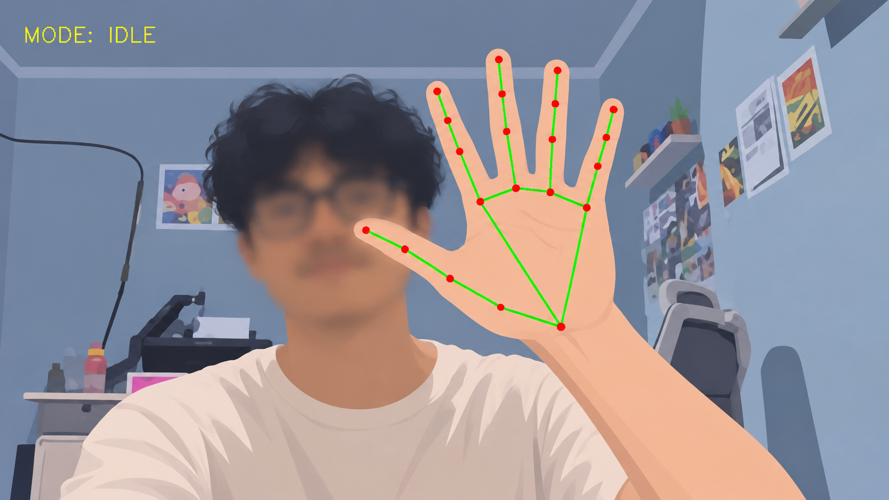
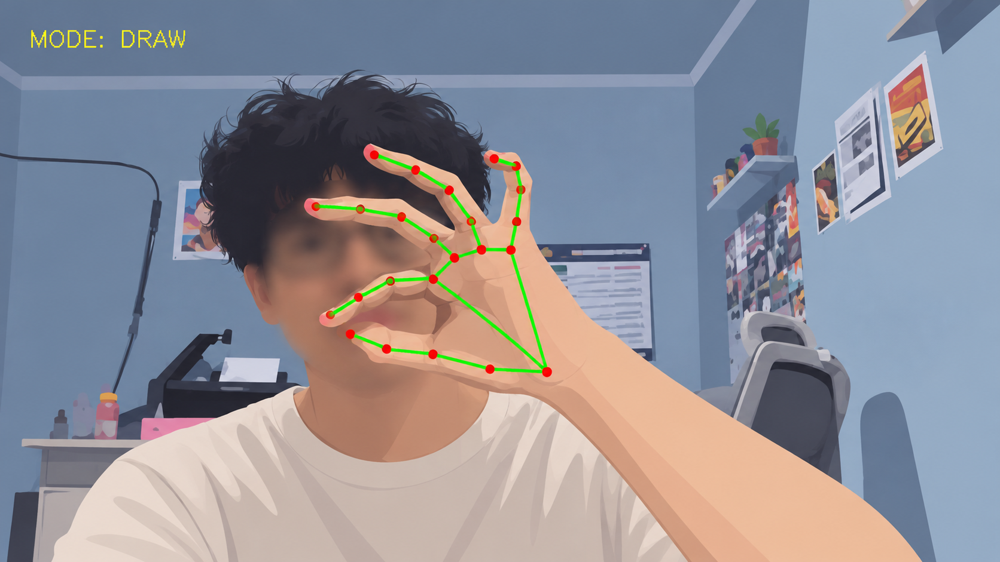
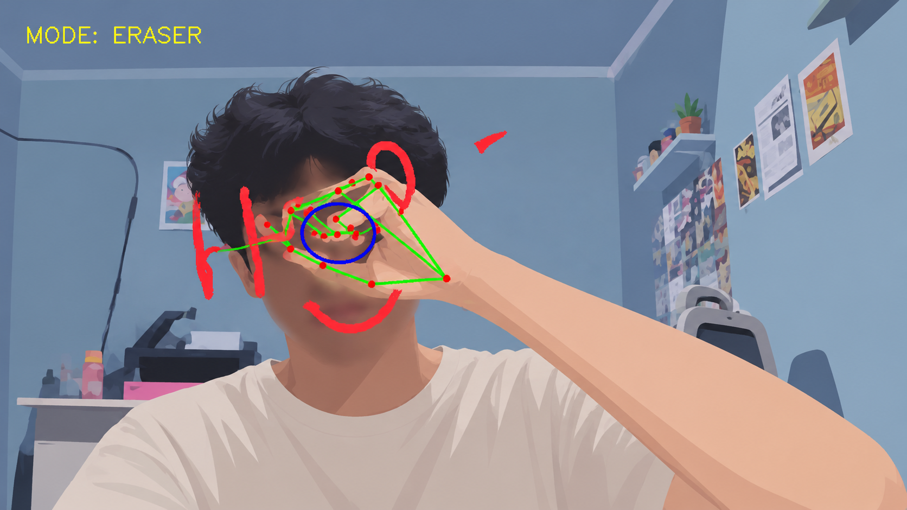
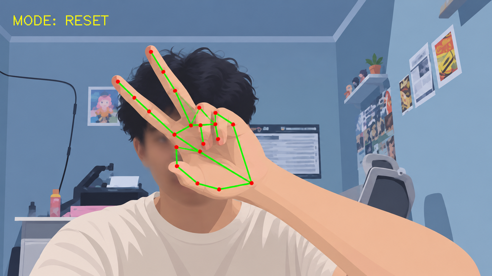

# Virtual Painter

Aplikasi **Virtual Painter** merupakan program menggambar dan menghapus gambar secara virtual menggunakan gestur tangan. Aplikasi ini dibuat dengan Python dan menerapkan pengolahan citra serta *computer vision* untuk mendeteksi gerakan tangan melalui webcam secara real-time.

Pengguna dapat menggambar, menghapus sebagian gambar, dan mengosongkan kanvas tanpa menggunakan mouse atau alat tulis fisik.

## Fitur Utama

- **Draw**: menggambar garis dengan gestur mencubit (*pinch*), yaitu mendekatkan ujung ibu jari dan jari telunjuk.
- **Eraser**: menghapus sebagian gambar dengan gestur mengepal (*fist*).
- **Reset**: menghapus seluruh gambar pada kanvas dengan gestur dua jari atau *peace*.
- **Idle**: mode saat tidak ada gestur menggambar, menghapus, atau reset yang aktif.
- **Deteksi real-time**: membaca gerakan tangan melalui kamera dan menampilkan hasilnya secara langsung.

## Teknologi yang Digunakan

| Teknologi | Kegunaan |
|---|---|
| Python | Bahasa pemrograman utama |
| OpenCV | Mengakses kamera, memproses frame, menggambar, dan menampilkan hasil |
| MediaPipe | Mendeteksi tangan dan landmark jari |
| NumPy | Membuat dan mengolah kanvas virtual |
| Math | Menghitung jarak antar titik jari |

## Kebutuhan Sistem

### Perangkat keras
- Laptop atau komputer
- Webcam atau kamera bawaan laptop
- Monitor atau layar

### Perangkat lunak
- Sistem operasi Windows
- Python
- Pustaka OpenCV, MediaPipe, dan NumPy
- Editor kode, misalnya Visual Studio Code atau PyCharm

## Cara Kerja

1. Program dijalankan menggunakan Python.
2. Sistem membuka webcam dan mengambil frame video.
3. OpenCV membaca serta memproses frame kamera.
4. MediaPipe mendeteksi tangan dan landmark jari.
5. Sistem mengenali gestur tangan yang dilakukan pengguna.
6. Program menjalankan mode yang sesuai, yaitu `DRAW`, `ERASER`, `RESET`, atau `IDLE`.
7. Kanvas virtual digabungkan dengan tampilan kamera dan hasilnya ditampilkan secara real-time.

## Panduan Gestur

| Gestur | Mode | Fungsi |
|---|---|---|
| Ibu jari dan telunjuk mencubit | `DRAW` | Menggambar garis mengikuti gerakan jari |
| Tangan mengepal | `ERASER` | Menghapus sebagian gambar |
| Gestur dua jari (*peace*) | `RESET` | Menghapus seluruh gambar pada kanvas |
| Tidak ada gestur aktif | `IDLE` | Menunggu gestur berikutnya |

**Catatan:** Gestur reset perlu terdeteksi selama beberapa frame sebelum seluruh kanvas dihapus. Sistem dalam proyek ini dikonfigurasi untuk mendeteksi satu tangan.

## Menjalankan Aplikasi

1. Pastikan Python sudah terpasang di komputer.
2. Pasang pustaka yang diperlukan:

   ```bash
   pip install opencv-python mediapipe numpy
   ```

3. Siapkan file source code proyek pada satu folder.
4. Buka terminal atau command prompt di folder tersebut.
5. Jalankan file Python utama, misalnya:

   ```bash
   python virtual_painter.py
   ```

   Ganti `virtual_painter.py` dengan nama file program utama yang digunakan pada proyek.

6. Izinkan akses kamera jika diminta, lalu posisikan tangan di depan kamera dengan pencahayaan yang cukup.

> Nama file utama dan susunan folder source code tidak dicantumkan secara spesifik dalam makalah. Sesuaikan perintah di atas dengan file program yang tersedia.


## Pengujian Mode

- **IDLE:** Kamera aktif dan aplikasi siap menerima gestur.

  

- **DRAW:** Sistem mendeteksi gestur mencubit dan menggambar mengikuti gerakan jari.

  

- **ERASER:** Sistem mendeteksi gestur mengepal dan menghapus bagian gambar.

  

- **RESET:** Sistem mendeteksi gestur dua jari selama beberapa frame dan menghapus seluruh isi kanvas.

  

## Kelebihan dan Keterbatasan

### Kelebihan
- Menggambar tanpa mouse atau alat tulis fisik.
- Dapat bekerja secara real-time menggunakan kamera.
- Mendukung menggambar, menghapus sebagian gambar, dan reset kanvas.
- Menggunakan rasio jarak jari terhadap ukuran tangan agar lebih fleksibel terhadap jarak tangan dari kamera.

### Keterbatasan
- Deteksi gestur dapat terganggu oleh pencahayaan yang kurang baik.
- Kualitas kamera dapat memengaruhi hasil deteksi.
- Gerakan tangan yang terlalu cepat dapat membuat garis kurang stabil.
- Posisi tangan yang tidak jelas dapat menyulitkan pengenalan gestur.
- Konfigurasi sistem saat ini hanya mendeteksi satu tangan.

## Tim Penyusun

Proyek ini dibuat oleh Kelompok 4 - R8E untuk mata kuliah **Pengolahan Citra**, dengan dosen pengampu **Ardhi Dinullah Baihaqie, M.Kom.**

| No. | Nama | NPM |
|---:|---|---|
| 1 | Adrizar Naufal | 202243500564 |
| 2 | Ahmad Mustafa | 202243500573 |
| 3 | Masrur Romzi | 202243500542 |
| 4 | Nur Faishal Ramdani | 202243500550 |
| 5 | Ridwan Romly | 202143502423 |
| 6 | Shelka Tri Anggoro | 202243500556 |
| 7 | Ulfatul Abadiyah | 202243500476 |
| 8 | Vernando Islamay Hartono | 202243500478 |

## Informasi Proyek

- **Nama proyek:** Virtual Painter
- **Topik:** Implementasi pengolahan citra untuk sistem menggambar dan menghapus virtual berbasis gestur tangan
- **Bahasa pemrograman:** Python
- **Mata kuliah:** Pengolahan Citra
- **Institusi:** Universitas Indraprasta PGRI
- **Tahun:** 2026
